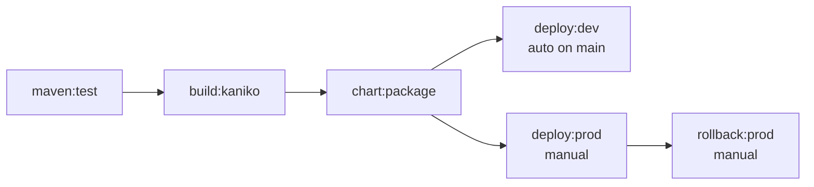

# 1. Pipeline anatomy

## Why this matters

Everything in GitLab CI reduces to three objects: **jobs** (units of work),
**stages** (ordering buckets), and **pipelines** (one run per commit/MR/tag).
Most real-world pipeline bugs are *ordering* bugs — a deploy that ran before
the image finished building, or a test that re-ran work another job already
published. Learn to read the graph and the bugs become obvious.

## The pipeline in this repo



Defined in `.gitlab-ci.yml` + `.gitlab/ci/*.yml`. Three things to notice:

1. **`needs:` beats stages.** `build:kaniko` says `needs: ["maven:test"]`
   instead of relying on stage order. `needs` builds a **DAG** — jobs start
   the moment their listed dependencies finish, skipping stages that don't
   apply. Without it, `deploy:dev` would wait for *every* package-stage job
   even though it only needs the chart.
2. **`rules:` decide *if* a job exists; `when:` decides *how*.** A job with
   no matching rule never enters the pipeline. `when: manual` (inside
   rules) means "present but waiting for a human click."
3. **`workflow:rules:` decides if the *pipeline* exists.** Without it,
   pushing a commit that has an open MR triggers *two* pipelines (branch +
   merge-request). The repo's workflow block kills the duplicate.

## Hands-on

1. Push any commit and open **CI/CD → Pipelines → (your pipeline)** — the
   graph view is the `needs` DAG rendered. Hover a job to see its rule
   evaluation.
2. Trigger an MR pipeline: open an MR, watch only MR-scoped jobs run.
3. Compare artifact flow: `chart:package` produces `dist/*.tgz`;
   `deploy:*` jobs `need` it, so GitLab hands them the artifact
   automatically (that's what `needs` carries beyond ordering).

```bash
# Local sanity-check before every push — catches syntax errors early:
glab ci lint .gitlab-ci.yml        # or GitLab UI → CI/CD → Editor → Lint
```

## Key keywords cheat sheet

| Keyword | Purpose |
|---------|---------|
| `image:` | container the job runs in |
| `script:` / `before_script:` / `after_script:` | shell commands; `before_script` runs first |
| `rules:` | conditional job inclusion (`if`, `changes`, `when`, `allow_failure`) |
| `needs:` | DAG edges + artifact passing |
| `artifacts:` | files handed to later jobs / the UI (`paths`, `reports:junit`) |
| `cache:` | keyed file cache between runs (maven repo, npm) |
| `environment:` | deployment tracking + gating (lesson 4) |
| `variables:` | env vars for job/pipeline scope |

## Deliberate break & triage

- **Break 1:** change `build:kaniko`'s `needs` to `["test"]` (wrong name).
  Lint fails: *"job needs 'test' but it was not found."* — needs refers to
  job names, not stage names.
- **Break 2:** make `maven:test` need `build:kaniko` → circular dependency
  error. Draw the DAG first; needs must point "left."
- **Break 3:** delete the `workflow:` block, push a commit on an MR branch →
  two pipelines appear. Explain why, then restore.

## Verify

- [ ] You can draw the pipeline DAG from memory
- [ ] You can explain the difference between `rules` and `only/except`
      (legacy — don't use it)
- [ ] `glab ci lint` passes on every file under `.gitlab/ci/`
