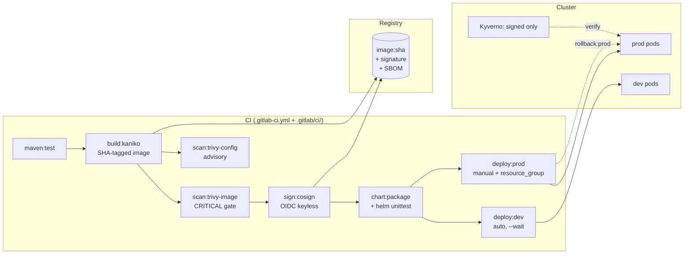

# 7. Capstone: The Full Loop, End to End

## What this proves

One push runs the entire curriculum: test → build → scan → sign → package
→ gated deploy → observe → rollback. If you can narrate every arrow in this
diagram from memory — with the file where it lives — you've finished the
course.

## The narrative — rehearse it

1. **`git push`** → `workflow:rules` decides this is one pipeline, not two.
2. **`maven:test`** runs (JUnit artifact for the UI); `cache:` keeps the
   `.m2` repo warm.
3. **`build:kaniko`** builds rootless, pushes `:<sha>` — immutable,
   traceable. DockerConcepts-07 explains *why* distroless would make this
   even better.
4. **`security` stage**: `scan:trivy-image` blocks on CRITICAL;
   `sign:cosign` signs with the job's own OIDC token — no keys anywhere
   (lesson 03 + DevSecOps theory).
5. **`chart:package`** lints + packages; `dist/*.tgz` flows via `needs`
   artifact handoff.
6. **`deploy:dev`** auto-deploys on main *only when app/chart changed*;
   `--wait` makes "deployed" mean "Ready."
7. **`deploy:prod`** waits for a human click, serialized by
   `resource_group: prod` — the audit trail is the `environment:` record.
8. **In-cluster**: Kyverno verifies the cosign signature at admission
   (KC lab 18); Flagger canaries the traffic shift (KC lab 14); ESO
   delivers the SSO secret (KC lab 12).
9. **Break**: bad tag → `pending-upgrade` wedge → `rollback:prod` →
   postmortem (DevOpsLearning labs 13–14).

## The self-test (close every file first)

| Question | File |
|----------|------|
| Where's the DAG edge between test and build? | `.gitlab/ci/build-kaniko.yml` → `needs` |
| Why can't a feature branch deploy prod? | `rules` + protected `KUBECONFIG_DATA` |
| Who proves the image is safe? | `scan:trivy-image` gate |
| Who proves the image is *ours*? | `sign:cosign` + Kyverno `verifyImages` |
| How does prod serialize? | `resource_group: prod` |
| What makes a failed deploy *look* failed? | `--wait` + probes |
| Where's the audit record of "who deployed"? | `environment: prod` deployments page |

Score yourself: 7/7 = ready to defend this pipeline in an interview.

## Final checklist before you call it done

- [ ] Pipeline ran green end-to-end on a real cluster at least once
- [ ] You caused AND resolved a `pending-upgrade` wedge
- [ ] `helm rollback` executed, not just read about
- [ ] A Kyverno `verifyImages` (or lab-18 equivalent) policy inspected
- [ ] One postmortem written — real or drill
- [ ] You can give the push-vs-pull (GitOps) answer in 30 seconds
